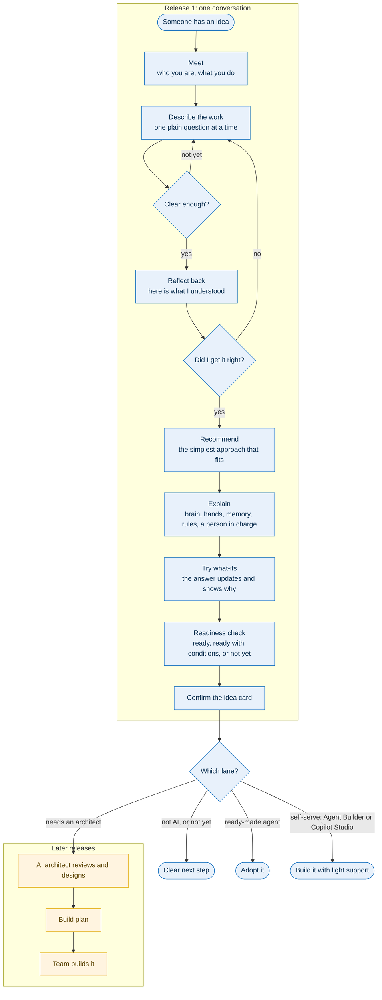

# agent-fit

> Is an agent the right fit?

**Status: early design. There is nothing to run yet.** This README describes what we are building and why, so the design can be reviewed before the code exists.

## Why agent-fit

Most organisations now have more AI ideas than they can build, and many of those ideas are labelled "agent" before anyone has checked that they need one.

- In June 2025, [Gartner predicted](https://www.gartner.com/en/newsroom/press-releases/2025-06-25-gartner-predicts-over-40-percent-of-agentic-ai-projects-will-be-canceled-by-end-of-2027) that over 40% of agentic AI projects will be cancelled by the end of 2027, because of escalating costs, unclear business value or inadequate risk controls. It also said that many use cases positioned as agentic today don't require an agentic implementation.
- Anthropic's guidance in [Building effective agents](https://www.anthropic.com/engineering/building-effective-agents) is to "find the simplest solution possible, and only increase complexity when needed", which "might mean not building agentic systems at all".

**agent-fit** puts that advice into practice. Anyone in your organisation can submit an idea in plain language. The system recommends the simplest approach that works: no AI, an AI-assisted step, a workflow, a single agent, or multiple agents. It then explains why, using rules you can read and change. Ideas that pass go on to an architect review and a build brief.

## What it does

agent-fit helps a person with no technical background turn an AI idea into a card that is complete enough for an AI architect to review. Along the way it teaches them how AI solutions work.

The first release is a single conversation that:

1. **Understands the person and their work.** It asks plain-language questions, one at a time, and adapts its wording to who it is talking to.
2. **Builds an idea card.** Each fact is recorded as stated, inferred or unknown, with the person's own words as evidence.
3. **Recommends the simplest approach that fits:** not AI, AI-assisted, workflow, single agent, multi-agent, or needs more information. It then points to the Microsoft option that fits that approach (see [Where an idea lands](#where-an-idea-lands)).
4. **Explains the answer and the parts.** The brain (the model), the hands (its tools), memory and knowledge, the rules, and a person in charge, each tied to the person's own idea.
5. **Lets them try what-ifs.** "What if a person approved every step?" The answer and the reasons update.
6. **Checks readiness before hand-off:** ready, ready with conditions, or not yet, with the gaps named.

## The journey

## Where an idea lands

agent-fit is **Microsoft first**: when an idea needs AI, it recommends the Microsoft option that fits, and it says so plainly when another option would serve better. The order follows Microsoft's own [technology plan for AI agents](https://learn.microsoft.com/en-us/azure/cloud-adoption-framework/ai-agents/technology-solutions-plan-strategy), which first asks whether a ready-made agent already meets the need and builds only if none does.

| Lane | When it fits | Who builds |
|---|---|---|
| **1. Not AI** | Fixed rules, or a report | Whoever owns the process |
| **2. Ready-made agent** | A Microsoft 365 Copilot or product agent already does it | Nobody, just adopt it |
| **3. Agent Builder** | One person or a small team, answering questions from their own content | The submitter |
| **4. Copilot Studio** | A department or customer-facing agent, multi-step work, approvals, simple integrations, low risk | A business maker, with support |
| **5. Architect-led** | Microsoft Foundry or custom code, multi-agent, high risk, strict repeatability, heavy integration | A pro-code team |

The choice between Agent Builder and Copilot Studio follows Microsoft's [comparison of the two](https://learn.microsoft.com/en-us/microsoft-365-copilot/extensibility/copilot-studio-experience): Agent Builder for individuals and small teams, Copilot Studio for wider audiences and more advanced capability and governance.

**Risk sets a ceiling on self-serve.** A high-risk answer, such as irreversible actions or sensitive data, can never land in lanes 3 or 4, so self-serve never becomes unsupervised AI.

*agent-fit is an independent project. It is not an official Microsoft tool, and product capabilities change, so each recommendation links to its source and should be checked before you build.*

## Design principles

- **Code decides, the model proposes.** The recommendation and the readiness check come from rules you can read and change. The model gathers evidence and writes the explanation. It never picks the verdict.
- **Never guess.** A missing answer stays unknown and becomes a named condition.
- **Input is data, not instructions.** Whatever a person types is never treated as a command.
- **The person stays in charge.** Nothing goes to an architect until the submitter confirms the card.
- **Simple first.** The system leans toward the simpler option, and a simple answer counts as a good result.
- **Honest about the platform.** Microsoft first, but never at the cost of the right answer.

## What it does not do

- It does not design the architecture, estimate cost, write a build plan or build anything. Those belong to the architect and later releases.
- It does not store personal data or require a login in this public version. It is meant to run locally with a mock model and no credentials.

## How we will know it works

- **Repeatable:** the same idea gives the same recommendation every time.
- **Not over-complicated:** it rarely recommends more than the idea needs.
- **Complete cards:** architects rarely have to send a card back.
- **Understood:** after the conversation, a non-technical person can explain the answer in their own words.

## Roadmap

1. **Release 1:** the conversation above, ending in a confirmed idea card.
2. **Later:** a starter specification for lanes 3 and 4 (instructions, knowledge sources, tools and guardrails a maker can start from), an interactive visual experience, the architect review for lane 5, and a build brief that a human team or a supervised agent team can work from.
