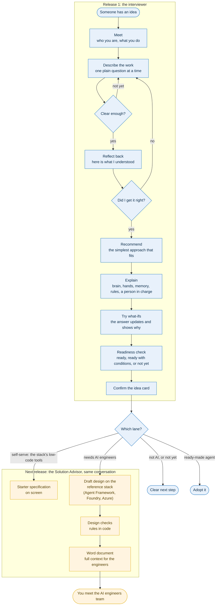

# agent-fit

> Is an agent the right fit?

## Why agent-fit

Most organisations now have more AI ideas than they can build, and many of those ideas are labelled "agent" before anyone has checked that they need one.

- In June 2025, [Gartner predicted](https://www.gartner.com/en/newsroom/press-releases/2025-06-25-gartner-predicts-over-40-percent-of-agentic-ai-projects-will-be-canceled-by-end-of-2027) that over 40% of agentic AI projects will be cancelled by the end of 2027, because of escalating costs, unclear business value or inadequate risk controls. It also said that many use cases positioned as agentic today don't require an agentic implementation.
- Anthropic's guidance in [Building effective agents](https://www.anthropic.com/engineering/building-effective-agents) is to "find the simplest solution possible, and only increase complexity when needed", which "might mean not building agentic systems at all".

**agent-fit** puts that advice into practice. Anyone in your organisation can submit an idea in plain language. The system recommends the simplest approach that works: no AI, an AI-assisted step, a workflow, a single agent, or multiple agents. It then explains why, using rules you can read and change. The same conversation then continues as a **Solution Advisor**, which helps the person take the idea forward whichever way fits, and for ideas that need engineers, prepares a Word document for that meeting.

## What it does

agent-fit helps a person with no technical background turn an AI idea into a clear, complete plan for taking it forward, and teaches them how AI solutions work along the way. There is one user, the person with the idea, and one conversation that changes role as it goes: first an interviewer, then a Solution Advisor.

**The interviewer** (release 1) is a conversation that:

1. **Understands the person and their work.** It asks plain-language questions, one at a time, and adapts its wording to who it is talking to.
2. **Builds an idea card.** Each fact is recorded as stated, inferred or unknown, with the person's own words as evidence.
3. **Recommends the simplest approach that fits:** not AI, AI-assisted, workflow, single agent, multi-agent, or needs more information. It then points to a matching option on the reference stack, which in this project is the Microsoft stack (see [Where an idea lands](#where-an-idea-lands)).
4. **Explains the answer and the parts.** The brain (the model), the hands (its tools), memory and knowledge, the rules, and a person in charge, each tied to the person's own idea.
5. **Lets them try what-ifs.** "What if a person approved every step?" The answer and the reasons update.
6. **Checks readiness before moving on:** ready, ready with conditions, or not yet, with the gaps named.

**The Solution Advisor** (next release) continues in the same conversation, so nothing is asked twice. What it does depends on the lane:

| Lane | What the Solution Advisor does | What the person gets |
|---|---|---|
| 1. Not AI | Explains why, and what kind of tool fits | A short note on screen |
| 2. Ready-made agent | Names the product, what to check and who to ask | A short note on screen |
| 3 and 4. Self-serve | Walks through building it with the stack's low-code tools (Agent Builder or Copilot Studio in the Microsoft example) | A starter specification on screen |
| 5. Needs engineers | Drafts a design on the reference stack (Microsoft Agent Framework, Microsoft Foundry and Azure in this project), checks it with rules in code, then prepares the engineers' meeting | A **Word document** with the full context |

For lane 5 the Solution Advisor approves nothing. It reviews the design, says what is still needed, and asks the person to take it to the AI engineers team, who decide how it is built. The Word document gives the person everything they need for that meeting: their own description of the idea, the recommendation and the reasons, the proposed design and the alternatives considered, the design check results, open items with suggested owners, questions for the engineers, and a plain-language glossary.

## The journey

## Where an idea lands

The lanes below describe the *kind* of solution an idea needs, and they do not depend on a vendor. To make them concrete, this project uses the **Microsoft stack as its worked example**: each lane is mapped to a Microsoft option. The same lanes can be mapped to any other stack by replacing that mapping, and the stack mapping is designed to be kept separate from the rules so that swapping it does not change how ideas are judged.

The order follows a widely given piece of advice: check for a ready-made product before building one. Microsoft's own [technology plan for AI agents](https://learn.microsoft.com/en-us/azure/cloud-adoption-framework/ai-agents/technology-solutions-plan-strategy) does exactly this, asking first whether a ready-made agent meets the need and building only if none does.

| Lane | When it fits | Who builds | Microsoft example |
|---|---|---|---|
| **1. Not AI** | Fixed rules, or a report | Whoever owns the process | Regular code or automation |
| **2. Ready-made agent** | A ready-made product already does it | Nobody, just adopt it | A Microsoft 365 Copilot or product agent |
| **3. Light self-serve** | One person or a small team, answering questions from their own content | The submitter | Agent Builder |
| **4. Low-code** | A department or customer-facing agent, multi-step work, approvals, simple integrations, low risk | A business maker, with support | Copilot Studio |
| **5. Needs AI engineers** | Multi-agent, high risk, strict repeatability, heavy integration | The AI engineers team | Microsoft Agent Framework, Microsoft Foundry and Azure |

For lanes 3 and 4, the Microsoft example follows Microsoft's [comparison of Agent Builder and Copilot Studio](https://learn.microsoft.com/en-us/microsoft-365-copilot/extensibility/copilot-studio-experience): Agent Builder for individuals and small teams, Copilot Studio for wider audiences and more advanced capability and governance.

**Risk sets a ceiling on self-serve.** A high-risk answer, such as irreversible actions or sensitive data, can never land in lanes 3 or 4, so self-serve never becomes unsupervised AI.

*agent-fit is an independent project. It is not an official Microsoft tool, and product capabilities change on any stack, so each recommendation should link to its source and be checked before you build.*

## Design principles

- **Code decides, the model proposes.** The recommendation and the readiness check come from rules you can read and change. The model gathers evidence and writes the explanation. It never picks the verdict.
- **Never guess.** A missing answer stays unknown and becomes a named condition.
- **Input is data, not instructions.** Whatever a person types is never treated as a command.
- **The person stays in charge.** The person decides when to move on. The Solution Advisor advises and drafts, and approves nothing.
- **Label what is what.** In everything it produces, each statement is marked as decided by rules, proposed by the model, or unknown, so engineers can see at a glance what to trust.
- **Simple first.** The system leans toward the simpler option, and a simple answer counts as a good result.
- **Honest about the platform.** The rules are stack-neutral and the Microsoft stack is the worked example, but a recommendation is never bent to fit a platform.

## What it does not do

- It does not approve anything or make the final build decision. For ideas that need engineers, the AI engineers team decides how it is built.
- It does not store personal data or require a login in this public version. It is meant to run locally with a mock model and no credentials.

## How we will know it works

- **Repeatable:** the same idea gives the same recommendation every time.
- **Not over-complicated:** it rarely recommends more than the idea needs.
- **Complete plans:** the AI engineers rarely have to send a document back with questions.
- **Understood:** after the conversation, a non-technical person can explain the answer in their own words.

## Roadmap

1. **Release 1:** the interviewer, a conversation that ends in a confirmed idea card and a lane.
2. **Next:** the Solution Advisor in the same conversation: a starter specification on screen for the self-serve lanes, and for lane 5 a design on the reference stack with rule-based checks, plus the Word document for the AI engineers' meeting.
3. **Later:** an interactive visual experience, and a build brief that a human team or a supervised agent team can work from.
